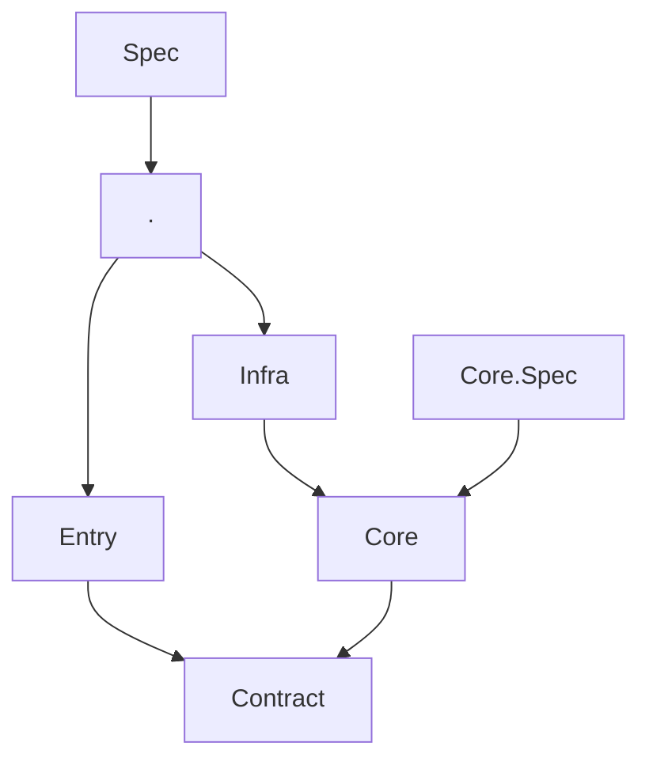

# Architecture plan

What lies between projects: the project graph, read from the spec project's build with no new dependency,
and the document an architecture spec writes. What lies inside a project is the package
TSpec.Architecture.CSharp's. Names in the examples are proposals; each step's *To decide* lists what is
open.

## Steps, in order

### 7. The architecture document

An architecture spec writes a readable page: its rules, and a diagram of the project graph.

```csharp
[assembly: AssemblyFixture(typeof(ArchitectureDocument))]
```

MyHotel's page would begin:

````markdown
# MyHotel architecture

## Project dependencies

- **are only these and not redundant**

| Project | May reference |
|---|---|
| . | Entry, Infra, P:Scalar.AspNetCore, P:Microsoft.* |
| Contract | P:Microsoft.* |
| Core | Contract, P:Microsoft.* |
| Core.Spec | Core, P:* |
| Entry | Contract, P:Microsoft.* |
| Infra | Core, P:Microsoft.* |
| Spec | ., P:* |


````

- *Requirement:* an architecture spec writes a document of its own into `_specification/` on every green
  run: its rules in words, and the graph they hold over as a diagram.
- *Motivation:* architecture rules are the claims a human owns, and a claim that reaches no document is
  second-class next to the examples. Today a reviewer sees an architecture change only as a diff of a
  switch expression. An architecture spec writes nothing: the document's subject is derived from the spec
  project's name, `Architecture` for M5's, which no project is, so M5 leaves `_specification/` out; and the
  document is built only from `Spec` classes, while architecture tests are plain classes.
- *Solution:* a page derived from what the architecture tests asserted: the built graph as a Mermaid
  diagram, and for each `Within`, what its rules allow each project — a rule is a function of the project,
  so it can be evaluated for every one. The test names state the rules in words, as in the other
  documents. M5's page would show its projects and the sub-domains of `Application`.
- *Design:* `Within` and `Redundant` record the graph, its root and the evaluated rules in the run, as a
  `Spec` records its requirements; a renderer beside `DocumentRenderer` writes the page with nodes and
  edges in ordinal order, so it diffs line by line; written only on a full green run, as now. Needs a
  design session and its own breakdown before code.
- *To decide:* how an architecture spec opts in without a subject; one page or one per test class; the
  built graph, the allowed graph or both; whether packages appear in the diagram; how a custom rule, a
  plain `Is().Empty()` over computed findings, reaches the page.

### 8. What a project reaches

Ask what a project depends on, directly or indirectly — the CDR needs it, M5 does not.

```csharp
[Fact]
public void Entry_never_reaches_Infra()
    => Source.Projects.Under("MyHotel")["Entry"].Reaches.Does().not.Contain("Infra");
```

- *Requirement:* a custom rule can ask what a project depends on directly or through other projects, named
  as the rules see them.
- *Motivation:* a project's `Dependencies` are its direct references only, and where `not.Redundant()` holds
  they omit everything reached through another project, so whether a host ships a project is not visible
  from them.
  TSpec computes the closure for `Redundant()` but keeps it private, so the CDR copies the walk
  (`Solution.Reached`) for three rules: each host's solution filter lists exactly its closure and the specs
  that reference into it; a store ships only into hosts that compose its module; no domain leaf could
  dissolve into a module.
- *Solution:* `Reaches` on `SourceProject`, with `Dependencies`' conventions: names as written under
  `Under(root)`, in ordinal order. Packages are included as the leaves they are in the graph, since a
  package's own dependencies are not in it; the project itself is not.
- *Design:* the graph hands each project its reach from the walk `Redundant()` uses, which works on full
  names, mapped out with `AsWritten` as `Dependencies` are. Tests in `Core.Test/Architecture/WhenReaches.cs`,
  on graphs built from a dictionary: a chain, a diamond reached once, the packages of reached projects, names
  under a root, a project with no references. One clause in README §7's custom-rule paragraph and in the
  agent reference's "Custom rules" line. A NEW note. Check: the CDR's three rules give today's findings on
  `Reaches`.
- *To decide:* the name.

## How to work a step

- Propose before code: the failing example, the behaviour, any new wording, and the docs line if a reader
  would otherwise get it wrong; for a rendering change, before and after.
- Test first. The suite green on all three frameworks, MyHotel green. Report and stop.
- Delete a step when it lands, and the plan with its last step.
