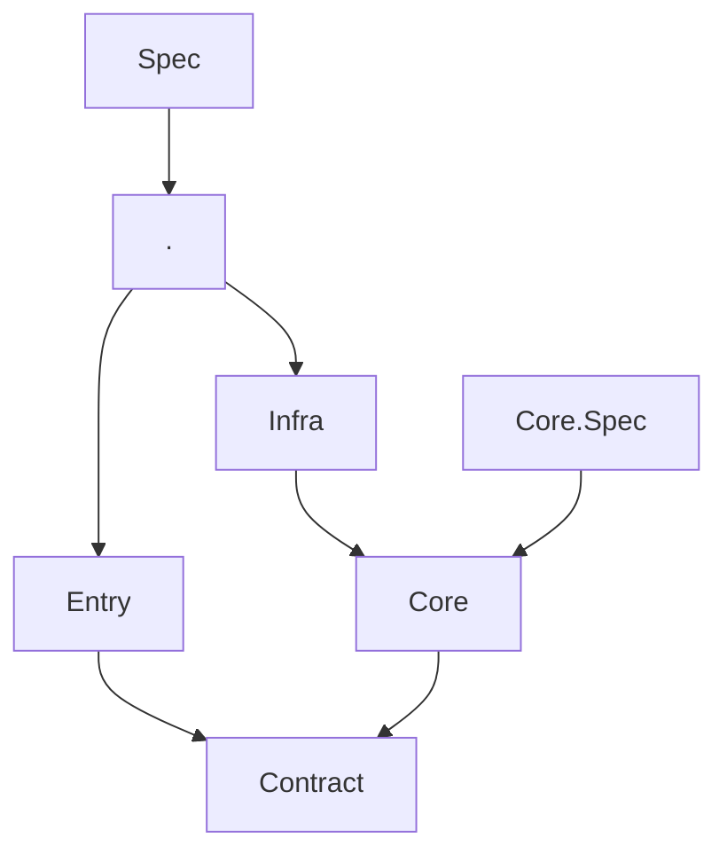

# Architecture plan

What M5 and the CDR write by hand in their Architecture.Spec projects, made TSpec's, and the document an
architecture spec writes. Everything is read from the spec project's build — its deps.json, the assemblies
and PDBs beside it, and the source files the PDBs name — with no new dependency. Names in the examples are
proposals; each step's *To decide* lists what is open.

## Source files

`Source.Projects` lists the build's projects as `SourceProject`s, the running spec project among them as
`CurrentSpec`, each with its `Dependencies` and its `Files`: its source files as `SourceFile`s that TSpec
owns, named by their project and their path in it, never by where they lie on disk; a failure names a file
the same way, `Application/Assistant/Assistant.cs`. A file has its text as written, `Raw`, and its `Lines`,
and gains what TSpec learns about it: the types declared in it, `Types`, then the types its code uses
(step 3) and what TSpec reads in its text itself (step 10).

An analysis TSpec does not have is added to the file, not done on the side: a C# extension member that
keeps what it computes in a table keyed by the file, since TSpec hands out the same file every time. M5's
`Source` record becomes a few such members, and with `Are` an allow-list is one expression:

```csharp
// M5's NestingDepth: exactly the listed files are too deep, each as deep as listed
[Fact]
public void Only_the_listed_files_are_indented_past_the_fifth_level()
    => Source.Projects.SelectMany(project => project.Files)
        .Select(file => (file.ToString(), file.Deepest))
        .Where(file => file.Deepest > Limit)
        .Are(Allowed);

internal static class M5Files
{
    private static readonly ConditionalWeakTable<SourceFile, SyntaxTree> _trees = new();

    extension(SourceFile file)
    {
        public SyntaxNode Root => _trees.GetValue(file, f => CSharpSyntaxTree.ParseText(f.Raw)).GetRoot();
        public int Deepest => file.Lines.Max(LevelOf);
    }
}
```

## Steps, in order

### 3. Every use of a type, and the file that writes it

Which types each file's code uses — what steps 4–6 are built on.

```csharp
// One edge of M5's sub-domain rule: Workbench never uses Assistant
[Fact]
public void Workbench_does_not_use_Assistant()
    => Source.Projects["Application"].Files
        .Where(file => file.Path.StartsWith("Workbench/", StringComparison.Ordinal))
        .Where(file => file.Uses.Any(type => type.StartsWith("Medrave.M5.Application.Assistant.", StringComparison.Ordinal)))
        .Is().Empty();
```

- *Requirement:* a custom rule can ask which types each file's code uses, in its own project and in others.
- *Motivation:* M5's `SubdomainDependencies` keeps the folders of `Application` one way — Chat at the
  bottom, Generation and Assistant on Chat, Workbench on Generation and Chat — by matching the first segment
  of every qualified name with Roslyn, in 75 lines; its `PublicTypes` matches identifiers across projects in
  155, so any identifier spelled like a type counts as a use of it. The CDR runs regexes over usings and
  tokens. The project graph cannot answer it, since `not.Redundant()` removes the edges a project still
  uses through another.
- *Solution:* each type's uses read from its signatures, its attributes and its methods' IL, and placed on a
  file through the PDB's sequence points, as `file.Uses`. Compiler-generated types — lambdas' closures, async and iterator
  state machines — count as the type that wrote them; a used type in another project resolves to it by
  assembly name.
- *Design:* an IL reader over each method body that collects the type, method and field tokens of its
  instructions and its local-variable signature, mapping a method or field to its declaring type; and a
  signature decoder (`System.Reflection.Metadata`'s type provider) for signatures and generic arguments,
  which steps 5 and 6 reuse. A use is kept once per file. Check: M5's `SubdomainDependencies` computed on it
  gives today's findings. M5 builds only with the CDR checkout on the branch it expects. The reader is a
  second reading mechanism of some 150 lines: propose its size before writing it. Blind spots: `nameof`
  and a `const` read compile to literals, and a `typeof` in an attribute is a name in its blob.
- *To decide:* whether the uses are also on the file's `Types`, for which type uses what; where a use with no
  line of its own — a field's type, an attribute — goes when its type is partial; whether uses of package
  and framework types are kept too, for rules such as "Core uses nothing from
  `System.Data`"; whether to read `typeof` out of attribute blobs; where M5's ports run — a local branch of
  M5 pointing at TSpec's working build, as MyHotel's `lib/` does, or a scratch copy.

### 4. Namespace dependencies

Rules for which namespaces may use which — M5's sub-domain rule (Chat, Generation, Assistant, Workbench) as
one switch.

```csharp
// M5's SubdomainDependencies; the second rule lets each sub-domain use itself
[Fact]
public void A_subdomain_uses_only_the_ones_below_it()
    => Source.Projects["Application"].Namespaces.Under("Medrave.M5.Application")
        .Is().Within(ns => ns.Segment(0) switch
        {
            "Generation" or "Assistant" => ["Chat*"],
            "Workbench" => ["Generation*", "Chat*"],
            _ => [],
        }, ns => [$"{ns.Segment(0)}*"]);
```

- *Requirement:* assert which namespaces may use which, with the same `Within` as for projects.
- *Motivation:* the most common architecture rule (NetArchTest and ArchUnitNET are built around it), and
  M5's newest rule is one: 75 lines of syntax matching, where M5's project graph is one switch. M5's
  CODING-STANDARD makes every folder a sub-domain (9a), so the same rule fits its other projects.
- *Solution:* a graph whose nodes are namespaces and whose edges are step 3's uses — namespace A uses
  namespace B when a type in A uses a type in B — with the project graph's mechanism: `Under`, `Segment`,
  `Within`, the trailing `*`, and a failure that names each offending edge.
- *Design:* build the edges from step 3's uses, and share `SourceProjects`'s name handling and `Within` rather
  than copy them: either `SourceProjects` takes namespace nodes, or the shared part moves to a base both
  graphs use. Tests mirror `WhenWithin` and `WhenUnder` with namespace names. Check: M5's
  `SubdomainDependencies` as a switch gives today's findings. A NEW note.
- *To decide:* the scope — one project's namespaces or all; whether the namespaces under a sub-domain fold
  into it, so `Workbench.Edits` counts as `Workbench`; whether edges to namespaces outside the root are
  kept; and whether `Within` can require every node to be placed, as M5's "every subdomain is placed in the
  graph" does, which a rule given as a function cannot show.

### 5. A public type no other project uses

A ready-made rule that such a type should be internal — M5's `PublicTypes`.

```csharp
// M5's PublicTypes; Contract is public by purpose
[Fact]
public void No_type_is_public_that_only_its_own_project_uses()
    => Source.Projects.Is().not.NeedlesslyPublic(except: ["Contract"]);
```

- *Requirement:* one assertion that finds each public type no other project uses.
- *Motivation:* M5 holds every production project to it (CODING-STANDARD 3b: anything that can be internal
  is) in 155 lines of identifier matching; the CDR asks a narrower form of its contract interfaces.
  Exposing no more than is used is common advice for an application's projects.
- *Solution:* an assertion on the graph over step 3's uses, with M5's exceptions: a type named in a public
  signature of its own project must stay public, and a use from the project's own spec does not count,
  since `InternalsVisibleTo` opens internals to it — read from the assembly's attributes, where M5 reads the
  csproj's text.
- *Design:* step 3's signature decoder over the public members of public types (base types, interfaces,
  member types, parameters, constraints). Port M5's `PublicTypes` first and diff its findings with today's,
  then build it in. A finding names the type, e.g. `Core.Orders.OrderMapper is public but no other project
  uses it`; `Fix` says why. A NEW note.
- *To decide:* the assertion's name; how a project whose public types are its purpose, such as M5's
  Contract or a library, is left out.

### 6. What exposed members take and return

Which types each public member takes and returns, for rules like M5's "no tuple in a public member".

```csharp
// M5's TupleMembers, without Roslyn
[Theory, MemberData(nameof(Projects))]
public void No_member_takes_or_returns_a_tuple(string project)
    => Source.Projects[project].Types
        .SelectMany(type => type.Members)
        .Where(member => !member.IsPrivate)
        .Where(member => member.Signature.Any(type => type.Contains("System.ValueTuple")))
        .Select(member => member.Name)
        .Is().Empty();
```

- *Requirement:* a custom rule can ask, for each type, its members — methods, constructors, properties,
  fields, events — each with its visibility and the types its signature takes and returns.
- *Motivation:* M5 checks with Roslyn that no public or internal member takes or returns a tuple
  (`TupleMembers`) or returns an `IEnumerable<T>` (`EnumerableMembers`); its boundary rule — nothing crosses
  as an enum, a custom value type, a time type other than `DateOnly`, `object` or `dynamic`
  (CODING-STANDARD 6b) — is unchecked. Rules on what an API exposes, such as "the contract carries records
  and primitives only", are common in architecture tools.
- *Solution:* each member of the files' `Types` with its visibility and its signature, decoded from metadata,
  which holds the resolved types: an alias or a `global using` in the source cannot hide what a member
  takes.
- *Design:* step 3's signature decoder over every member. A property stands for its accessors,
  compiler-generated members are left out, and a record's positional parameters are its properties. A tuple
  is a `ValueTuple`; `dynamic` is `object` marked by a `DynamicAttribute`, which the decoder reads. Port
  M5's two rules and write 6b on it, and diff. A NEW note.
- *To decide:* how a signature's types are exposed — names such as `System.ValueTuple<int, string>`, or a
  small type model; whether nullable annotations are read; whether a project lists its types, a partial
  one once, as the example's `Types`, or a rule goes through its files and takes them distinct.

### 7. The architecture document

An architecture spec writes a readable page: its rules, and a diagram of the project graph.

```csharp
[assembly: AssemblyFixture(typeof(ArchitectureDocument))]
```

MyHotel's page would begin:

````markdown
# MyHotel architecture

## Project dependencies

- **are only these and not redundant**

| Project | May reference |
|---|---|
| . | Entry, Infra, P:Scalar.AspNetCore, P:Microsoft.* |
| Contract | P:Microsoft.* |
| Core | Contract, P:Microsoft.* |
| Core.Spec | Core, P:* |
| Entry | Contract, P:Microsoft.* |
| Infra | Core, P:Microsoft.* |
| Spec | ., P:* |


````

- *Requirement:* an architecture spec writes a document of its own into `_specification/` on every green
  run: its rules in words, and the graph they hold over as a diagram.
- *Motivation:* architecture rules are the claims a human owns, and a claim that reaches no document is
  second-class next to the examples. Today a reviewer sees an architecture change only as a diff of a
  switch expression. An architecture spec writes nothing: the document's subject is derived from the spec
  project's name, `Architecture` for M5's, which no project is, so M5 leaves `_specification/` out; and the
  document is built only from `Spec` classes, while architecture tests are plain classes.
- *Solution:* a page derived from what the architecture tests asserted: the built graph as a Mermaid
  diagram, and for each `Within`, what its rules allow each project — a rule is a function of the project,
  so it can be evaluated for every one. The test names state the rules in words, as in the other
  documents. M5's page would show its projects and the sub-domains of `Application`.
- *Design:* `Within` and `Redundant` record the graph, its root and the evaluated rules in the run, as a
  `Spec` records its requirements; a renderer beside `DocumentRenderer` writes the page with nodes and
  edges in ordinal order, so it diffs line by line; written only on a full green run, as now. Needs a
  design session and its own breakdown before code.
- *To decide:* how an architecture spec opts in without a subject; one page or one per test class; the
  built graph, the allowed graph or both; whether packages appear in the diagram; how a custom rule, a
  plain `Is().Empty()` over computed findings, reaches the page.

### 8. What a project reaches

Ask what a project depends on, directly or indirectly — the CDR needs it, M5 does not.

```csharp
[Fact]
public void Entry_never_reaches_Infra()
    => Source.Projects.Under("MyHotel")["Entry"].Reaches.Does().not.Contain("Infra");
```

- *Requirement:* a custom rule can ask what a project depends on directly or through other projects, named
  as the rules see them.
- *Motivation:* a project's `Dependencies` are its direct references only, and where `not.Redundant()` holds
  they omit everything reached through another project, so whether a host ships a project is not visible
  from them.
  TSpec computes the closure for `Redundant()` but keeps it private, so the CDR copies the walk
  (`Solution.Reached`) for three rules: each host's solution filter lists exactly its closure and the specs
  that reference into it; a store ships only into hosts that compose its module; no domain leaf could
  dissolve into a module.
- *Solution:* `Reaches` on `SourceProject`, with `Dependencies`' conventions: names as written under
  `Under(root)`, in ordinal order. Packages are included as the leaves they are in the graph, since a
  package's own dependencies are not in it; the project itself is not.
- *Design:* the graph hands each project its reach from the walk `Redundant()` uses, which works on full
  names, mapped out with `AsWritten` as `Dependencies` are. Tests in `Core.Test/Architecture/WhenReaches.cs`,
  on graphs built from a dictionary: a chain, a diamond reached once, the packages of reached projects, names
  under a root, a project with no references. One clause in README §7's custom-rule paragraph and in the
  agent reference's "Custom rules" line. A NEW note. Check: the CDR's three rules give today's findings on
  `Reaches`.
- *To decide:* the name.

### 9. Port the CDR's usage rules and diff

Rewrite the CDR's hand-made usage rules on steps 3 and 8, to check they work there too.

```csharp
// The CDR's "every contract interface is consumed by an entry or host", its exceptions left out
private static readonly HashSet<string> UsedByEntryOrHost =
    [.. Source.Projects.Where(project => project.Name.IsEntry() || project.Name.IsHost())
        .SelectMany(project => project.Files)
        .SelectMany(file => file.Uses)];

[Fact]
public void Every_contract_interface_is_used_by_an_entry_or_host()
    => Source.Projects.Where(project => project.Name.IsContract())
        .SelectMany(project => project.Files)
        .SelectMany(file => file.Types)
        .Where(type => type is { Kind: DeclaredKind.Interface, IsPublic: true })
        .Where(type => !UsedByEntryOrHost.Contains(type.FullName))
        .Select(type => type.FullName)
        .Is().Empty();
```

- *Requirement:* evidence that steps 3 and 8 serve the CDR's rules as they serve M5's.
- *Motivation:* the CDR's rules have shapes M5's lack — contract interfaces consumed by an entry or host,
  stores shipped only with their module, domain leaves that could dissolve, and an entry file speaking to
  at most one contract namespace — all matched from source text, comments included, "so the tolerance is
  toward passing". A second consumer is what shows a reading is general.
- *Solution:* rewrite the four rules on step 3's uses and step 8's reach, run them against the CDR's build,
  and compare not only pass and fail but the sets each computes on the way: the interfaces an entry or host
  uses, the hosts that ship each store, the modules that use each leaf, the contract namespaces each entry
  file uses.
- *Design:* old and new side by side, one scratch test per rule printing both sets and their differences,
  each classed as a reader bug, an old-rule error or a blind spot. The outcome is a report; nothing in
  TSpec changes unless it shows a gap.
- *To decide:* where the port runs, as for M5's in step 3.

### 10. What TSpec reads in a file's text

What the build does not keep — comments, the content of string literals, how code is laid out — read from a
file's text by TSpec, so a layout rule needs no parser of its own.

```csharp
// M5's NestingDepth without Roslyn: a raw string's content is not indentation
extension(SourceFile file)
{
    public int Deepest => file.Lines.Where((_, index) => file.IsCode(index)).Max(LevelOf);
}
```

- *Requirement:* a custom rule can tell, for each line of a file, whether it holds code, only a comment, or
  the content of a string literal.
- *Motivation:* M5's layout rules (`LineWidths`, `NestingDepth`) leave out the content of raw string
  literals, which only a parser finds, so M5 brings Roslyn for them; its syntax rules (`ArgumentLists`,
  `ConditionalBranches`, `ExpressionLines`) need a syntax tree. Roslyn is about 10 MB, fifteen times TSpec,
  and tied to the C# version: M5 moved to 5.0 to parse C# 14.
- *Solution:* a reader of C#'s lexical grammar — comments, character, string, verbatim, interpolated and raw
  string literals — that marks each line of a file; more of the syntax only where a rule shows the need.
- *Design:* beside `Lines`, which stay the file's text. Needs a design session: where a reader of TSpec's
  own stops, and Roslyn added through an extension is the better answer.
- *To decide:* what a line carries; whether TSpec reads any syntax beyond lines; what a file the reader
  cannot follow, such as one with a preprocessor branch, gives.

## How to work a step

- Propose before code: the failing example, the behaviour, any new wording, and the docs line if a reader
  would otherwise get it wrong; for a rendering change, before and after.
- Test first. The suite green on all three frameworks, MyHotel green. Report and stop.
- Delete a step when it lands, and the plan with its last step.
