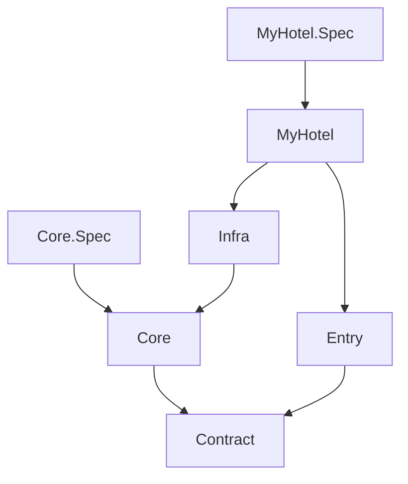

# My Hotel

<!-- Generated by TSpec from MyHotel.Architecture.Spec. Do not edit by hand. -->



## Core specs

- **Each spec sits in the folder of the class it specifies**\
  `CoreSpecFiles has all CoreClassFolders.Contains(FolderOf(file))`
- **Each spec file declares one spec** — `CoreSpecFiles has all file.Types.Count == 1`

## Layers

- **Contract declares only public types** — `Types of "Contract" has all type.IsPublic`
- **Infra declares no interface**\
  `Types of "Infra" has none type.Kind == DeclaredKind.Interface`

## Project dependencies

- **Are only these and not redundant**

  | Project      | May reference | May use                        |
  | ------------ | ------------- | ------------------------------ |
  | MyHotel      | Entry, Infra  | Scalar.AspNetCore, Microsoft.* |
  | Contract     | -             | Microsoft.*                    |
  | Core         | Contract      | Microsoft.*                    |
  | Core.Spec    | Core          | *                              |
  | Entry        | Contract      | Microsoft.*                    |
  | Infra        | Core          | Microsoft.*                    |
  | MyHotel.Spec | MyHotel       | *                              |

  ```
  Source.Projects.Under("MyHotel") is within what is allowed
      and not redundant
  ```
