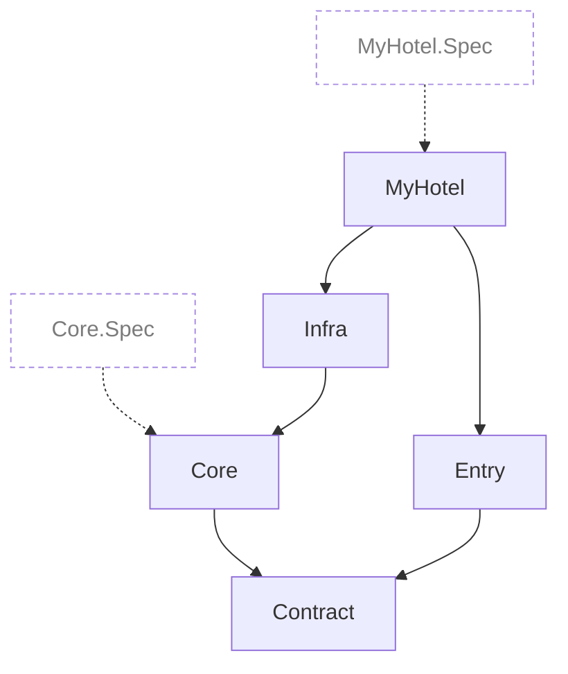

# My Hotel

<!-- Generated by TSpec from MyHotel.Architecture.Spec. Do not edit by hand. -->



## Core specs

- **Each spec sits in the folder of the class it specifies**\
  `CoreSpecFiles.Where(file => !CoreClassFolders.Contains(FolderOf(file))) is empty`
- **Each spec file declares one spec**\
  `CoreSpecFiles.Where(file => file.Types.Count != 1) is empty`

## Layers

- **Contract declares only public types**\
  `TypesOf("Contract").Where(type => !type.IsPublic) is empty`
- **Infra declares no interface**\
  `TypesOf("Infra").Where(type => type.Kind == DeclaredKind.Interface) is empty`

## Project dependencies

- **Are only these and not redundant**
  ```
  Source.Projects.Under("MyHotel") is within
      and not redundant
  ```
